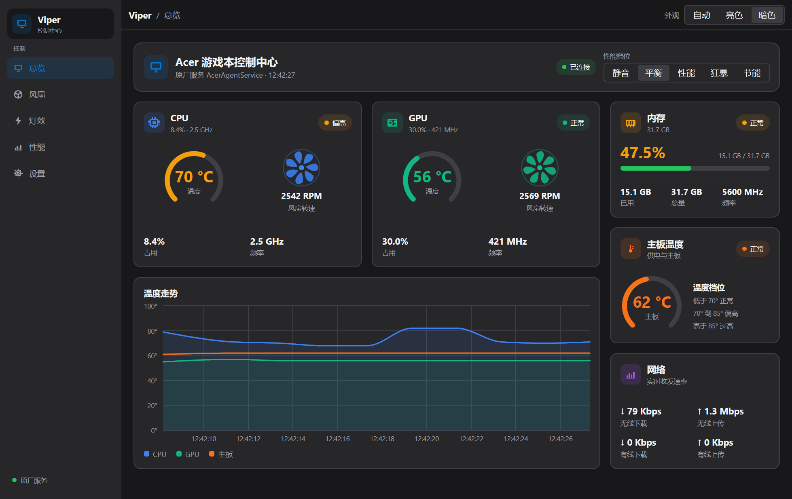
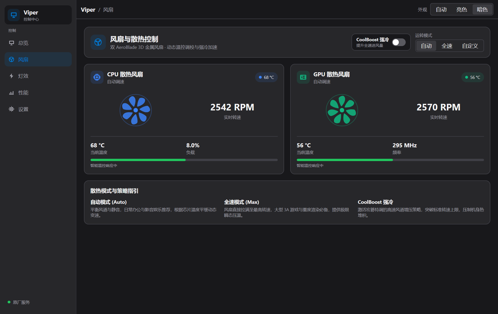
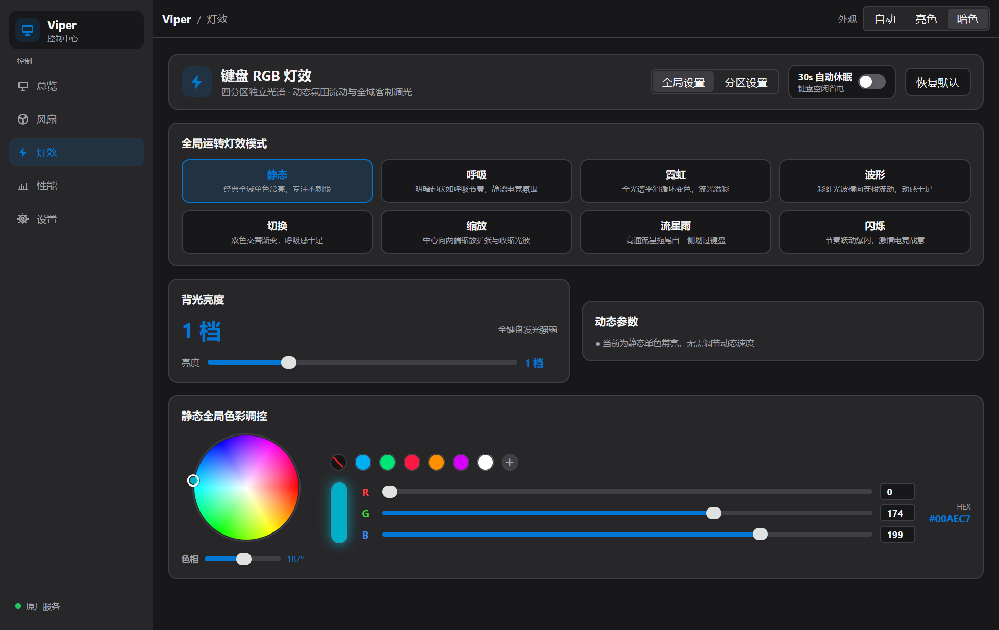
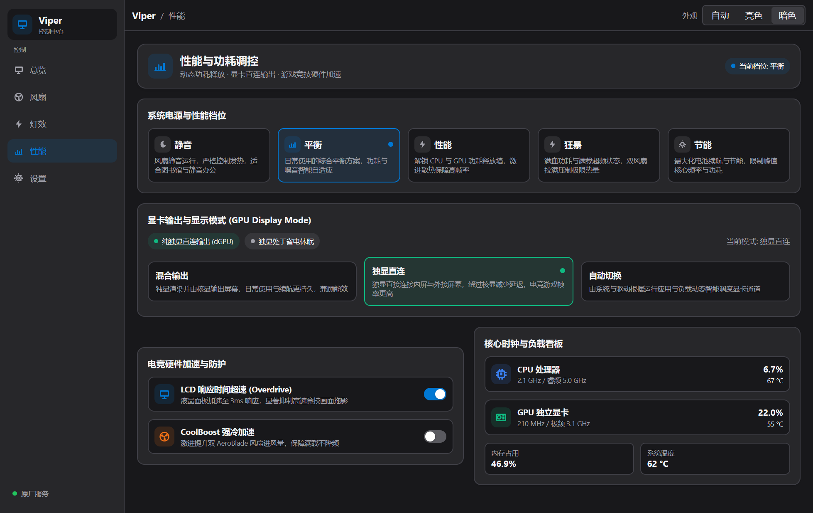
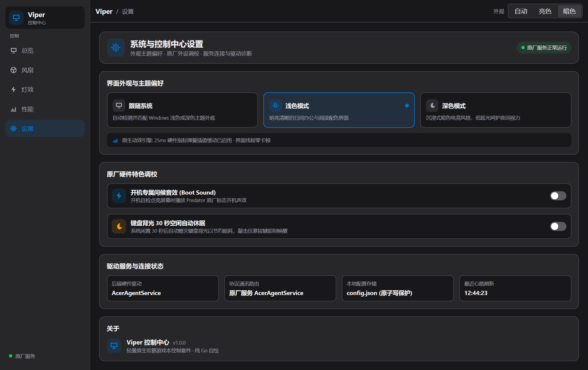

<div align="center">

# 🐍 Viper

**专为宏碁掠夺者 (Predator) 与暗影骑士 (Nitro) 打造的原生极速硬件控制中心与 CLI 工具套件**

*纯 Go 原生自绘，告别 500MB 臃肿 UWP，毫秒级冷启动，~30MB 极致轻量内存占用*

[](https://github.com/qzh200/Viper/releases/latest)
[](https://github.com/qzh200/Viper/releases)
[](https://github.com/qzh200/Viper/stargazers)
[](https://github.com/qzh200/Viper/issues)
[](LICENSE)
[](https://go.dev/)
[-0078D6?style=flat-square&logo=windows)](https://microsoft.com/windows)
[](#)
[](#)
[](#)

[功能特性](#-核心特性) • [对比优势](#-为什么选择-viper) • [快速开始](#-快速开始) • [界面预览](#-界面预览-screenshots) • [图形控制中心](#-图形控制中心-viperui) • [命令行手册](#-命令行工具-viper) • [架构设计](#-架构设计) • [常见问题](#-常见问题与故障排查)

<br>

<p align="center">
  
</p>

</div>

---

## 💡 为什么选择 Viper？

官方的原厂控制软件（PredatorSense / NitroSense）通常存在体积庞大（完整安装包超过 500MB）、重度依赖微软商店 UWP 架构、后台常驻服务占用数百兆内存以及无法通过脚本自动化调控等痛点。

**Viper** 采用纯 Go 语言实现，直接对接原厂底层服务协议，抛弃了所有 Webview、Chromium 与 Electron 运行时，带来毫秒级启动与极致的运行效率：

| 对比维度 | 官方 PredatorSense / NitroSense | Viper 控制中心 |
| :--- | :--- | :--- |
| **运行时依赖** | 臃肿的 UWP / 微软应用商店全家桶 | **纯 Go 原生可执行文件，零多余依赖** |
| **安装包体积** | 约 500 MB+ | **核心驱动约 28 MB，工具仅单文件** |
| **内存开销** | 300 MB ~ 600 MB (多后台进程) | **~30 MB (GUI 运行中) / <10 MB (后台)** |
| **启动响应** | 3 ~ 8 秒（冷启动缓慢） | **< 50 毫秒（瞬间呈现）** |
| **界面绘制引擎** | Webview / WinUI / Electron 混合 | **原生硬件 GPU 自绘引擎 (MyGo)** |
| **自动化支持** | ❌ 无命令行，不支持脚本控制 | **✔️ 全功能 CLI，支持终端一键批处理与场景联动** |
| **外观主题** | 强制深色或跟随系统 | **自动 / 明亮 / 暗黑 三档自由切换** |

---

## ✨ 核心特性

### 📊 实时遥测与多维监控
- **核心温控指标**：CPU、独立 GPU、主板/供电模组 (VRM) 实时温度采集；
- **转速与频率**：双风扇真实转速 (RPM)、CPU 睿频与 GPU 核心/显存频率、实时负载利用率；
- **系统与网络遥测**：物理内存占用量与频率、Wi-Fi 与千兆/2.5G 有线以太网即时上下行吞吐速率；
- **动态曲线图表**：内置低开销历史温度平滑走势图，性能瓶颈一目了然。

### 🚀 性能档位与功耗模式
- **瞬时档位切换**：
  - `Quiet`（静音模式）：压制发热与风噪，办公与影音首选；
  - `Balanced`（平衡模式）：智能兼顾能效比与日常负载；
  - `Performance`（高性能模式）：解除基础功耗墙，高帧率游戏畅玩；
  - `Turbo`（狂暴/极速超频）：拉满功耗上限与硬件超频频率；
  - `Eco`（节能模式）：移动办公长续航支持。

### ❄️ 双 AeroBlade 3D 风扇控制
- **灵活策略**：
  - `Auto`：交由硬件 EC 策略全自动线性温控；
  - `Max`：一键双风扇拉满 100% 极限转速，强力压温；
  - `Custom`：支持对 CPU 与 GPU 风扇独立指定 0%~100% 占空比；
- **CoolBoost 强冷加速**：硬件级散热增强开关，优化温控触发曲线。

### 🌈 4 分区 RGB 键盘背光工作台
- **8 种动态光效动画**：常亮 (Static)、呼吸 (Breathing)、霓虹 (Neon)、波浪 (Wave)、切换 (Shifting)、缩放 (Zoom)、流星 (Meteor)、闪烁 (Twinkling)；
- **精细化调色**：支持全区域统一调色或 4 分区独立调色，内置直观的色相/饱和度调色板；
- **动态属性定制**：1~9 档连续速度微调、向左/向右流动方向控制、1~5 档物理背光亮度；
- **节能与维护**：支持键盘闲置 30 秒自动休眠熄屏，以及一键重置恢复原厂纯白背光。

### 🎮 游戏特权与显卡直连
- **显示直连模式**：
  - `Hybrid`（混合输出 / Optimus）：独显渲染、集显输出，兼顾续航；
  - `Discrete`（独显直连 / MUX 开关）：独显直接输出屏幕，降低延迟并释放满血性能；
  - `Auto`：由系统动态调度显示链路；
- **竞技外设保障**：一键锁定 Windows 徽标键（防误触跳出游戏）；
- **响应速度增强**：支持开启/关闭 LCD Overdrive 液晶响应时间超速加速。

### 🔋 QuickAccess 深度协同
- **关机对外供电**：支持在关机状态下使用笔记本 USB 接口给外设/手机充电，并提供电池保护截止阈值（10%、20%、30%）；
- **开机问候音效**：支持一键开启或静默掠夺者专属开机问候音效 (Boot Sound)；
- **Windows 桌面定制**：一键同步 Windows 深色模式、亚克力透明视觉特效、任务栏自动隐藏与屏保等待时间。

### 🔄 场景自动化引擎 (Scenario Engine)
- 支持将心仪的风扇转速策略与键盘 RGB 灯效组合保存为具名场景；
- 支持将场景与性能档位进行自动绑定（例如：切换至 Turbo 档位自动应用狂暴冷光与 100% 满速风扇）。

---

## 📦 快速开始

### 方式 A：免安装发行包使用（推荐）

1. 前往 GitHub Releases 页面下载最新版本：  
   👉 [**下载 Viper 最新发布包**](https://github.com/qzh200/Viper/releases/latest) （例如：[`Viper-v1.0.0-windows-x64.zip`](https://github.com/qzh200/Viper/releases/download/v1.0.0/Viper-v1.0.0-windows-x64.zip)）；
2. 解压到任意目录（例如 `D:\Tools\Viper`）；
3. **首次使用前注册底层服务**：
   - 右键以管理员身份运行 `安装原厂核心服务 (右键管理员运行).bat`；
   - 脚本将自动静默配置 Acer 原厂底层通信驱动（大小仅约 28MB，无需安装 500MB+ 官方商店软件）；
4. **运行控制中心**：
   - 双击 `bin\viperui.exe` 打开原生图形控制台；
   - 或在终端中执行 `bin\viper.exe status` 体验 CLI 调控。

> [!NOTE]
> 若后续需要彻底清理或不再使用，只需右键管理员身份执行 `卸载原厂核心服务 (右键管理员运行).bat` 即可干净卸载所有服务项。

---

### 方式 B：从源码编译构建

#### 环境准备
- 操作系统：Windows 10 / 11 (x64)
- 编程语言：Go 1.20 或更高版本
- 终端环境：PowerShell

#### 获取源码并编译
```powershell
git clone https://github.com/qzh200/Viper.git
cd Viper

# 批量编译套件中所有程序 (viper, viperui, agcheck, fanproto, winkey)
.\build.ps1
```

编译成功后，所有可执行文件将生成于 `bin/` 目录：
- `bin/viperui.exe`：原生图形交互界面
- `bin/viper.exe`：命令行主程序
- `bin/agcheck.exe`：底层协议与硬件读写回环校验诊断工具
- `bin/fanproto.exe`：风扇协议写入延迟探测工具
- `bin/winkey.exe`：Windows 键锁状态探针

若仅需单独构建 CLI 或 GUI：
```powershell
go build -o bin/viper.exe ./cmd/viper
go build -o bin/viperui.exe ./cmd/viperui
```

---

## 🖥️ 图形控制中心 (`viperui`)

`viperui` 采用 [MyGo](https://github.com/egoist/mygo) 绘制引擎直接在 GPU 上渲染界面，不使用任何 HTML/CSS，不嵌入浏览器组件，内存开销仅约 30MB。

### 📸 界面预览 (Screenshots)

<div align="center">

| 首页总览 (Home) | 双风扇散热控制 (Fans) |
| :---: | :---: |
|  |  |

| 4 分区 RGB 背光灯效 (Lighting) | 性能档位与显卡直连 (Power) |
| :---: | :---: |
|  |  |

<br>

<p align="center">
  <b>高级系统协同与外观设置 (Settings)</b><br><br>
  
</p>

</div>

### 命令行选项

```bash
# 启动图形控制中心
viperui

# 指定外观主题启动（可选：auto跟随系统、light亮色、dark暗色）
viperui --theme dark

# 启动并直接跳转至指定标签页（可选：home总览、fans风扇、lighting灯效、power性能、settings设置）
viperui --page fans

# 无头测试/渲染：将界面当前渲染帧直接截屏输出为 PNG 图片后退出
viperui --screenshot preview.png
```

### 页面功能一览
1. **总览 (Home)**：系统硬件监视圆盘、CPU/GPU 动态温度折线图、当前性能模式与风扇状态快速概览；
2. **风扇 (Fans)**：CPU 与 GPU 风扇独立 RPM 表盘显示、自动/全速/自定义占空比滑块、CoolBoost 强冷开关；
3. **灯效 (Lighting)**：4 分区键盘可视化调色板、8 种动态灯效切换、流动速度/方向/亮度档位、闲置 30 秒休眠开关；
4. **性能 (Power)**：静音/平衡/性能/狂暴/节能五档一键切换、独显直连/混合输出 MUX 切换、LCD Overdrive 加速与 Win 键锁；
5. **设置 (Settings)**：界面主题切换（自动/浅色/深色）、关机 USB 供电阈值设置、掠夺者开机声音开关、Windows 视觉效果集成。

---

## ⌨️ 命令行工具 (`viper`)

Viper CLI 专为键盘极客、自动化脚本与批处理设计，支持细粒度的硬件操作与即时查询。

### 1. 硬件遥测与状态查询
```bash
# 查询硬件简要运行状态（温度、风扇转速、当前负载）
viper status

# 查看完整硬件传感器遥测详情（频率、电压、各传感器指标、网络即时速率）
viper telemetry

# 执行底层硬件能力与服务支持状态全方位自检
viper diag
```

### 2. 散热与风扇调控
```bash
# 查看当前双风扇运转模式与各风扇实际 RPM
viper fans

# 恢复硬件温控策略自动调速
viper fan auto

# 开启全速模式（双风扇拉满 100% 极限转速）
viper fan max

# 自定义风扇占空比：分别设置 CPU 70% 与 GPU 80%
viper fan custom 70 80

# 开启 / 关闭 CoolBoost 强冷加速
viper fan coolboost on
viper fan coolboost off
```

### 3. 电源与性能档位
```bash
# 查看当前电源模式
viper power

# 切换电源模式：quiet | balanced | performance | turbo | eco
viper power turbo
viper power balanced
```

### 4. 显卡模式与显示直连
```bash
# 查看当前显卡输出工作状态
viper gpu

# 切换显示工作模式：
# hybrid   - 混合输出 (Optimus，独显渲染集显输出)
# discrete - 独显直连 (dGPU 绕过集显直连屏幕)
# auto     - 自动调度
viper gpu discrete
```

### 5. 竞技外设与屏幕响应
```bash
# 查看竞技配置状态（屏幕超速与 Win 键锁定）
viper profile

# 开启 / 关闭 LCD Overdrive 响应时间加速
viper profile overdrive on

# 锁定 / 解锁键盘 Windows 徽标键（防止游戏误切）
viper profile winkey on
```

### 6. 4 分区 RGB 键盘灯效
```bash
# 查看当前键盘灯效配置
viper lighting

# 一键恢复出厂纯白常亮背光
viper lighting reset

# 开启 / 关闭键盘背光闲置 30 秒自动休眠熄灭
viper lighting timeout on

# 设置全局纯红常亮背光，最高亮度 (5档)
viper lighting set effect static color #FF0000 brightness 5

# 设置动态波浪灯效，流动速度 7 档，流动方向向右
viper lighting set effect wave speed 7 direction 1 brightness 4

# 分区独立调色：第 0 区蓝色、第 1 区青色、第 2 区橙色、第 3 区紫色
viper lighting set zone 0 #0000FF zone 1 #00FFFF zone 2 #FFA500 zone 3 #800080 all
```

> **灯效参数速查表**：
> - `effect`：`static` (常亮) \| `breathing` (呼吸) \| `neon` (霓虹) \| `wave` (波形) \| `switch` (切换) \| `scale` (缩放) \| `meteor` (流星) \| `flash` (闪烁)
> - `speed`：速度调节，范围 `1` ~ `9`
> - `direction`：方向调节，`0` (向左) 或 `1` (向右)（仅 wave 与 switch 模式有效）
> - `brightness`：物理亮度档位，范围 `1` ~ `5`（5 为最高亮度）

### 7. 电池管理与系统协同 (QuickAccess)
```bash
# 查看关机 USB 供电状态与截止阈值
viper charge

# 开启 / 关闭关机状态下 USB 端口对外充电
viper charge usb on
viper charge usb off

# 设置关机对外充电的电池保护截止百分比（支持 10、20、30%）
viper charge limit 20

# 开启 / 关闭掠夺者专属开机问候音效
viper bootsound on

# 切换 Windows 深色模式
viper darkmode on

# 开启 / 关闭 Windows 窗口亚克力透明视觉特效
viper transparent on

# 开启 / 关闭 Windows 任务栏自动隐藏
viper taskbar on

# 设置屏幕保护程序空闲超时等待时间（秒）
viper screensaver timeout 300
```

### 8. 场景联动引擎 (Scenario Engine)
```bash
# 列出本地已保存的所有场景
viper scenario list

# 将当前的背光与风扇设定保存为名为 "GamingTurbo" 的场景
viper scenario save GamingTurbo

# 即时应用指定场景
viper scenario apply GamingTurbo

# 将场景与性能档位绑定（例如：切入 turbo 档位时自动加载 GamingTurbo 场景）
viper scenario bind turbo GamingTurbo

# 解除性能档位的场景绑定
viper scenario unbind turbo

# 删除指定场景
viper scenario delete GamingTurbo
```

---

## 🏗️ 架构设计

Viper 遵循清晰的分层架构模式，严格将底层通信、核心业务门面、配置存储与上层展现解耦：

```text
               ┌───────────────────────────┐     ┌───────────────────────────┐
               │    CLI (cmd/viper)        │     │    GUI (cmd/viperui)      │
               └─────────────┬─────────────┘     └─────────────┬─────────────┘
                             │                                 │
                             ▼                                 ▼
                     ┌─────────────────────────────────────────────────┐
                     │            Facade (internal/app)                │
                     │          (场景联动引擎 / 硬件读写协调门面)          │
                     └───┬─────────────┬─────────────┬─────────────────┘
                         │             │             │
        ┌────────────────┘             │             └────────────────┐
        ▼                              ▼                              ▼
┌──────────────────────┐   ┌──────────────────────┐   ┌──────────────────────┐
│   machine.Backend    │   │     quickaccess      │   │     config.Store     │
│ (写后轮询核验驱动实现)   │   │  (关机充电/系统桌面)  │   │ (%APPDATA%/Viper)    │
└──────────┬───────────┘   └──────────┬───────────┘   └──────────────────────┘
           │                          │
           ▼ (TCP: 127.0.0.1:46933)   ▼ (TLS/WebSocket: 127.0.0.1:5141)
┌──────────────────────┐   ┌──────────────────────┐
│   AcerAgentService   │   │   Acer QuickAccess   │
│   (原厂底层监控与控制)   │   │    (系统拓展控制服务) │
└──────────────────────┘   └──────────────────────┘
```

- **`internal/app`**：顶层业务门面与场景引擎，向 CLI 与 GUI 统一暴露硬件调控方法与数据结构；
- **`internal/machine`**：实现硬件驱动抽象，引入 **写后核验 (Verify-After-Write)** 轮询校验机制，确保硬件真正完成状态变迁后再行返回；
- **`internal/agentservice`**：底层二进制帧协议封包与流式解包客户端，通过标准 TCP Socket (`127.0.0.1:46933`) 与服务通讯，使用花括号嵌套深度平衡算法解析非定长 JSON 响应流；
- **`internal/quickaccess`**：针对 Acer QuickAccess 服务的 TLS + WebSocket 客户端，集成 AES-128-ECB 动态问答身份鉴权；
- **`internal/gui`**：基于 MyGo 的原生渲染实现，彻底将纯展示模型 (`model`)、外观模式 (`theme`) 与硬件交互控制器 (`controller`) 隔离，支持无头测试及 PNG 快照渲染；
- **`internal/config`**：负责场景预设、性能绑定、外观模式与用户偏好的持久化管理，采用临时文件写入、安全权限校验及原子替换 (Atomic Rename) 流程杜绝配置损坏。

---

## 🛠️ 底层探针与取证工具

Viper 内置了专为硬件逆向研究与排错设计的诊断工具套件：

- **`agcheck`**：原厂通信链路状态取证与回环读写校验；
  ```powershell
  agcheck read      # 原始读取原厂服务所有数据帧
  agcheck write     # 测试原厂服务写操作
  agcheck machine   # 通过 machine 驱动层读取硬件抽象
  agcheck verify    # 自动执行读写一致性回环压力检验
  ```
- **`fanproto`**：风扇控制指令延迟与占空比写入延迟探测取证；
  ```powershell
  # 测试写入并追踪风扇状态回弹与收敛时延
  fanproto 2 0 70 0 80
  ```
- **`winkey`**：针对 Windows 徽标键硬件锁闭与释放时序的自动化探测。

---

## 💻 兼容性与硬件支持

本项目经过深入的硬件驱动逆向与实机验证，理论支持所有搭载 **AcerAgentService** 架构的宏碁游戏笔记本：

- **掠夺者 Predator 系列**：
  - Predator Helios 16（PH16-71, PH16-72 等）
  - Predator Helios 18（PH18-71, PH18-72 等）
  - Predator Helios Neo 16 / Neo 18
  - Predator Triton 14 / 16 / 17
- **暗影骑士 Nitro 系列**：
  - Nitro 16（AN16-41, AN16-51, AN16-71, AN16-72 等）
  - Nitro 17（AN17-41, AN17-51, AN17-71, AN17-72 等）
  - Nitro 5（AN515-58, AN517-55 等）
  - Nitro V 15 / V 16（ANV15-41, ANV15-51, ANV16-71 等）

---

## ❓ 常见问题与故障排查

<details>
<summary><b>Q1: 运行 viper 或 viperui 提示 "无法连接到原厂服务"？</b></summary>
<br>

Viper 负责与宏碁底层硬件服务通信。若服务尚未运行：
1. 请先确保以管理员权限执行了压缩包内的 `安装原厂核心服务 (右键管理员运行).bat`；
2. 在 Windows 终端运行 `net start AcerAgentService` 确认服务处于运行状态；
3. 原厂服务默认监听 `127.0.0.1:46933`，请检查是否有本地第三方安全软件拦截了 Loopback 本地端口通信。
</details>

<details>
<summary><b>Q2: 切换显示直连 (Discrete) 模式后没有立刻生效？</b></summary>
<br>

硬件级独显直连 (MUX Switch) 切换通常需要重新启动计算机或重新建立显示会话，这是笔记本硬件主板的物理设计机制，属于正常现象。
</details>

<details>
<summary><b>Q3: 自定义风扇占空比后，风扇转速为什么会略微浮动？</b></summary>
<br>

风扇物理马达具有惯性与最低启动转速阈值。通过 `viper fan custom <cpu%> <gpu%>` 指定的是占空比百分比，底层温控芯片会根据当前转速闭环反馈进行平滑升降速，避免突兀的风噪突变。
</details>

<details>
<summary><b>Q4: 本地配置文件保存在哪里？</b></summary>
<br>

Viper 将配置持久化在 `%APPDATA%\Viper\config.json`（通常为 `C:\Users\<用户名>\AppData\Roaming\Viper\config.json`）。该文件保存了自定义场景、外观主题以及性能档位联动配置。
</details>

---

## 👥 作者与社区

- **项目主页**：[https://github.com/qzh200/Viper](https://github.com/qzh200/Viper)
- **作者**：[@qzh200 (跨越星轨的客)](https://github.com/qzh200)
- **个人博客**：[blog.hoshiumi.xyz](http://blog.hoshiumi.xyz/)
- **联系邮箱**：[2563070658@qq.com](mailto:2563070658@qq.com)
- **问题反馈**：欢迎通过 [GitHub Issues](https://github.com/qzh200/Viper/issues) 提交 Bug 或功能建议

---

## 📄 开源许可证

本项目采用 [MIT 许可证](LICENSE) 开源。

```text
MIT License

Copyright (c) 2026 qzh200 <2563070658@qq.com>

Permission is hereby granted, free of charge, to any person obtaining a copy
of this software and associated documentation files (the "Software"), to deal
in the Software without restriction, including without limitation the rights
to use, copy, modify, merge, publish, distribute, sublicense, and/or sell
copies of the Software, and to permit persons to whom the Software is
furnished to do so, subject to the following conditions:

The above copyright notice and this permission notice shall be included in all
copies or substantial portions of the Software.
```

---

<div align="center">
  <sub>Made with ❤️ by <a href="https://github.com/qzh200">qzh200</a> for the Predator & Nitro community.</sub>
</div>
